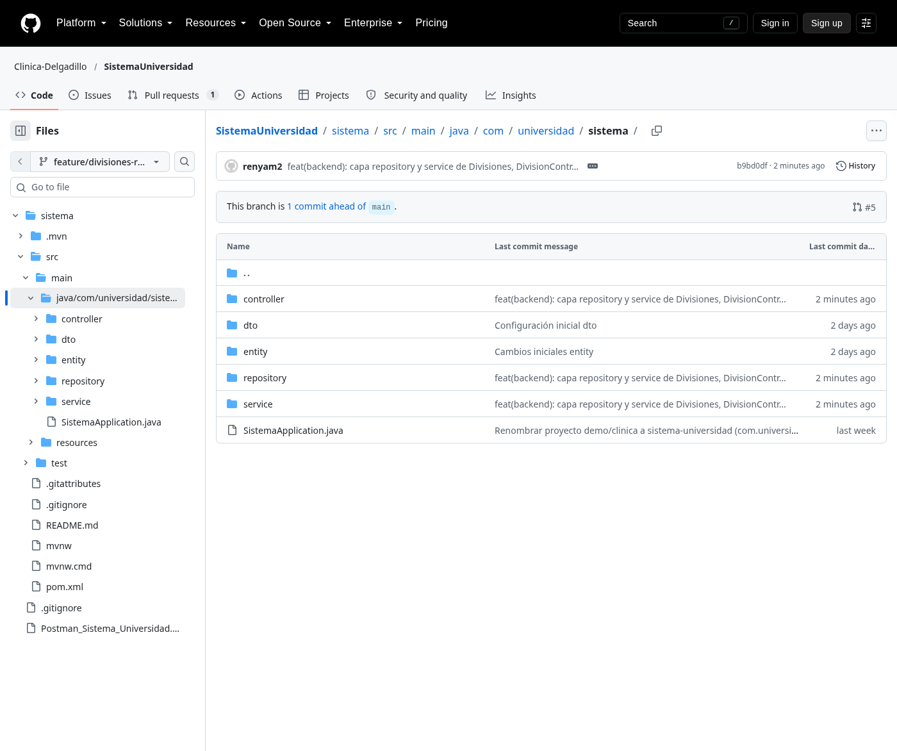
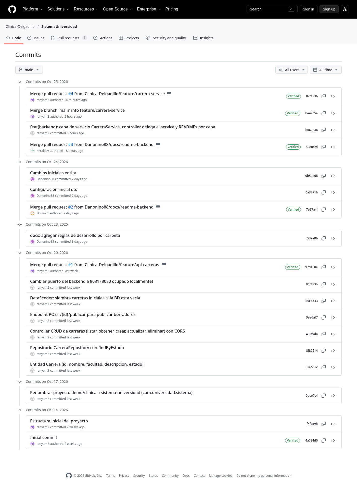
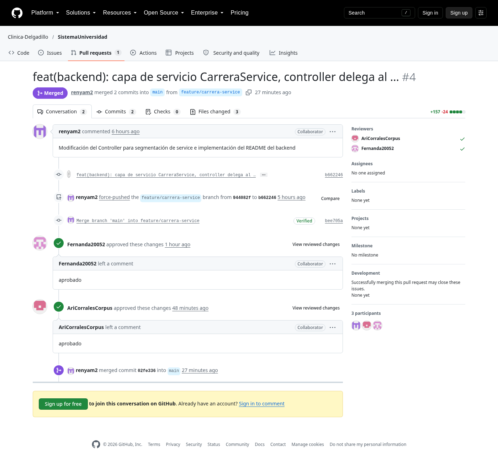
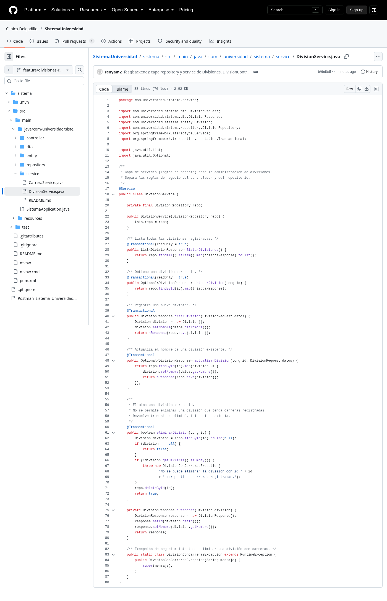
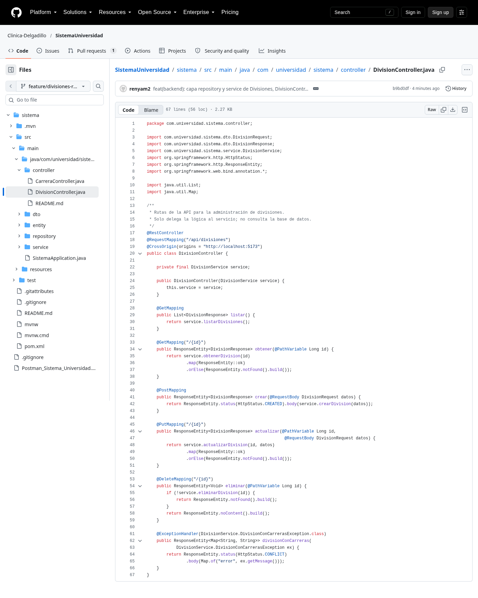
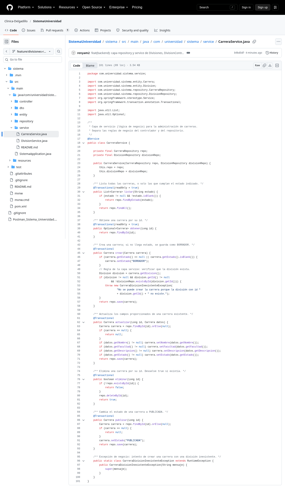

# Reporte de Desarrollo (DE)

**Materia:** Desarrollo Web Integral
**Institución:** Universidad Tecnológica de Querétaro
**Equipo:** Clínica Delgadillo (Oscar Daniel, Nuvia Yasmin, Elian Eduardo, Aldair, Estefany Ariadna, Fernanda)
**Repositorio:** https://github.com/Clinica-Delgadillo/SistemaUniversidad
**Responsable de este documento:** Elian Eduardo Ramírez (renyam2) — capa repository y service del microservicio

---

## 1. Caso de estudio y product backlog

El microservicio implementa el módulo de **administración académica** de la universidad: las **divisiones** y las **carreras** que pertenecen a cada división. A partir del caso de estudio se definió el siguiente backlog:

### Epic 01 — Administración académica de divisiones y carreras

| ID | Historia de usuario | Criterios de aceptación |
|----|---------------------|--------------------------|
| HU-01.1 | Como administrador académico, quiero registrar una división, para poder agrupar las carreras de la universidad. | 1. Puedo crear una división indicando su nombre (201). 2. Puedo listar todas las divisiones (200). 3. Puedo obtener una división por su id (200) y recibir 404 si no existe. 4. Puedo actualizar el nombre de una división (200). 5. Puedo eliminar una división (204), pero el sistema **no permite** eliminar una división que tenga carreras registradas (409). |
| HU-01.2 | Como administrador académico, quiero registrar una carrera asociada a una división, para completar el catálogo académico. | 1. Puedo crear una carrera con nombre, descripción y división (201); el estado inicial es BORRADOR. 2. El sistema **no permite** crear una carrera si la división no existe (409). 3. Puedo listar carreras (200) y obtenerlas por id (200), con 404 si no existe. 4. Puedo actualizar una carrera (200). 5. Puedo eliminar una carrera (204). |
| HU-01.3 | Como estudiante, quiero consultar las carreras publicadas, para elegir mi plan de estudios. | 1. Puedo publicar una carrera (BORRADOR → PUBLICADA) mediante `POST /api/carreras/{id}/publicar` (200). 2. Puedo filtrar carreras por estado con `GET /api/carreras?estado=PUBLICADA` (200). |

---

## 2. Arquitectura del microservicio (estado actual)

```
sistema/src/main/java/com/universidad/sistema/
├── SistemaApplication.java
├── controller/
│   ├── CarreraController.java   (delega al service; maneja 404 y 409)
│   └── DivisionController.java  (nuevo en PR #5)
├── dto/
│   ├── CarreraRequest.java
│   ├── CarreraResponse.java
│   ├── DivisionRequest.java
│   └── DivisionResponse.java
├── entity/
│   ├── Carrera.java
│   └── Division.java
├── repository/
│   ├── CarreraRepository.java
│   └── DivisionRepository.java  (nuevo en PR #5)
└── service/
    ├── CarreraService.java       (ampliado en PR #5: valida división existente)
    └── DivisionService.java      (nuevo en PR #5)
```

### Responsabilidad de cada capa

| Capa | Responsabilidad | Reglas cumplidas |
|------|-----------------|------------------|
| entity | Define las tablas y la relación 1-a-many (una división tiene varias carreras). | `@Entity`, `@Table`, `@Id`, `@GeneratedValue`, `@ManyToOne`, `@OneToMany(mappedBy = "division")`. |
| dto | Define qué información recibe y devuelve la API. | `Request` recibe, `Response` devuelve; sin `@Entity`, sin BD, sin lógica de negocio; campo `divisionId` para identificar la división. |
| repository | Acceso a datos mediante `JpaRepository`. | `CarreraRepository` y `DivisionRepository` extienden `JpaRepository<Entidad, Long>` sin consultas SQL propias. |
| service | Lógica de negocio. | No consulta la BD directamente (usa el repository), no maneja HTTP, usa los DTO acordados, verifica que el registro exista antes de actualizar/eliminar, valida que la división exista al crear una carrera y no permite eliminar una división con carreras. |
| controller | Rutas de la API. | Solo delega al service, recibe y devuelve DTOs (divisiones) o entidades (carreras, acuerdo previo del equipo), mapea estados HTTP y no contiene lógica de negocio. |

---

## 3. Endpoints implementados

### Divisiones (PR #5)

| Método | Ruta | Descripción | Estado esperado |
|--------|------|-------------|-----------------|
| GET | /api/divisiones | Listar todas las divisiones | 200 |
| GET | /api/divisiones/{id} | Obtener una división por id | 200 / 404 |
| POST | /api/divisiones | Crear una división | 201 |
| PUT | /api/divisiones/{id} | Actualizar el nombre de una división | 200 / 404 |
| DELETE | /api/divisiones/{id} | Eliminar una división | 204 / 404 / 409 (si tiene carreras) |

### Carreras (PR #1 y #4, ampliado en PR #5)

| Método | Ruta | Descripción | Estado esperado |
|--------|------|-------------|-----------------|
| GET | /api/carreras | Listar carreras | 200 |
| GET | /api/carreras?estado=PUBLICADA | Listar carreras publicadas | 200 |
| GET | /api/carreras/{id} | Obtener una carrera por id | 200 / 404 |
| POST | /api/carreras | Crear una carrera (estado inicial BORRADOR) | 201 / 409 (división inexistente) |
| PUT | /api/carreras/{id} | Actualizar una carrera | 200 / 404 |
| DELETE | /api/carreras/{id} | Eliminar una carrera | 204 / 404 |
| POST | /api/carreras/{id}/publicar | Publicar una carrera (BORRADOR → PUBLICADA) | 200 / 404 |

---

## 4. Flujo de desarrollo (control de versiones)

### Ramas creadas por el equipo

| Rama | Autor | Contenido | PR |
|------|-------|-----------|----|
| feature/back | Oscar Daniel | Repository CarreraRepository + DataSeeder | PR #1 (cerrado) |
| feature/api-carreras | Nuvia Yasmin | DTOs + READMEs por capa | PR #2 (cerrado) |
| docs/readme-backend | Daniel | READMEs de entity, dto, repository, service y controller | PR #3 (fusionado) |
| feature/carrera-service | Elian Eduardo | CarreraService + controller delegando al service | PR #4 (fusionado) |
| feature/divisiones-repo-service | Elian Eduardo | DivisionRepository, DivisionService, DivisionController, validaciones de negocio, colección Postman | PR #5 (abierto, en revisión) |

### Commits de la capa repository y service (Elian Eduardo)

| Commit | Mensaje |
|--------|---------|
| 39c1e21 | feat(backend): implementa CarreraRepository con JpaRepository |
| b0cd533 | DataSeeder: siembra carreras iniciales si la BD está vacía |
| b662246 | feat(backend): capa de servicio CarreraService, controller delega al service y READMEs por capa |
| b9bd0df | feat(backend): capa repository y service de Divisiones, DivisionController y validaciones de negocio |

---

## 5. Pruebas por historia de usuario (Postman)

Se generó la colección **`Postman_Sistema_Universidad.json`** (incluida en el repositorio) con todas las peticiones por historia de usuario. Todas las pruebas se verificaron contra la aplicación corriendo (Spring Boot 3.5, Java 17, H2 en memoria):

### HU-01.1 — División

| # | Petición | Cuerpo | Resultado esperado | Resultado obtenido |
|---|----------|--------|--------------------|--------------------|
| 1 | POST /api/divisiones | {"nombre":"Ingeniería"} | 201 + id | 201 {"id":1,"nombre":"Ingeniería"} |
| 2 | POST /api/divisiones | {"nombre":"Ciencias"} | 201 + id | 201 {"id":2,"nombre":"Ciencias"} |
| 3 | GET /api/divisiones | — | 200 lista | 200 [{"id":1,...},{"id":2,...}] |
| 4 | GET /api/divisiones/1 | — | 200 | 200 {"id":1,"nombre":"Ingeniería"} |
| 5 | GET /api/divisiones/999 | — | 404 | 404 |
| 6 | PUT /api/divisiones/1 | {"nombre":"Ingeniería Industrial"} | 200 | 200 {"id":1,"nombre":"Ingeniería Industrial"} |
| 7 | DELETE /api/divisiones/1 | — | 409 (tiene carreras) | 409 {"error":"No se puede eliminar la división con id 1 porque tiene carreras registradas."} |
| 8 | DELETE /api/divisiones/2 | — | 204 | 204 |

### HU-01.2 — Carrera

| # | Petición | Cuerpo | Resultado esperado | Resultado obtenido |
|---|----------|--------|--------------------|--------------------|
| 9 | POST /api/carreras | {"nombre":"Computación","descripcion":"Lic. en Computación","division":{"id":1}} | 201, estado BORRADOR | 201 {"id":1,...,"estado":"BORRADOR"} |
| 10 | POST /api/carreras | {"nombre":"Fantasma","descripcion":"x","division":{"id":999}} | 409 (división no existe) | 409 {"error":"No se puede crear la carrera porque la división con id 999 no existe."} |
| 11 | GET /api/carreras | — | 200 lista | 200 [carrera con división "Ingeniería Industrial"] |
| 12 | GET /api/carreras/1 | — | 200 | 200 |
| 13 | GET /api/carreras/999 | — | 404 | 404 |
| 14 | PUT /api/carreras/1 | {"nombre":"Computación Avanzada",...,"division":{"id":1}} | 200 | 200 |
| 15 | DELETE /api/carreras/1 | — | 204 | 204 |

### HU-01.3 — Consulta de carreras publicadas

| # | Petición | Cuerpo | Resultado esperado | Resultado obtenido |
|---|----------|--------|--------------------|--------------------|
| 16 | POST /api/carreras/1/publicar | — | 200, estado PUBLICADA | 200 {"estado":"PUBLICADA"} |
| 17 | GET /api/carreras?estado=PUBLICADA | — | 200 solo publicadas | 200 [carrera PUBLICADA] |

**Capturas de Postman:** se toman importando la colección `Postman_Sistema_Universidad.json` en Postman (Import → seleccionar archivo), ejecutando cada petición y capturando la respuesta (ver sección 7).

---

## 6. Evidencias del repositorio (capturas)

### 6.1 Repositorio y estructura




### 6.2 Commits




### 6.3 Pull requests del equipo





### 6.4 Código de la capa repository y service








---

## 7. Pendientes y guía de capturas

1. **Revisión del PR #5:** un compañero del equipo debe revisar y aprobar el PR #5 (GitHub no permite auto-revisión). El PR ya incluye un comentario del autor explicando las decisiones de diseño.
2. **Capturas de Postman:** importar `Postman_Sistema_Universidad.json` en Postman, ejecutar las 17 peticiones de la sección 5 y capturar cada respuesta (pantalla completa con método, URL, estado y cuerpo). Guardarlas en `capturas/postman-hu01-1.png`, `capturas/postman-hu01-2.png`, `capturas/postman-hu01-3.png` y agregarlas a la sección 5 de este documento.
3. **Capturas de los demás integrantes:** cada integrante agrega las capturas de su código, commits y PRs (ya se incluyeron los PR #1, #3 y #4 del equipo).
4. **Fusión del PR #5:** una vez aprobado, fusionar a `main` y actualizar este reporte con el commit de fusión.
